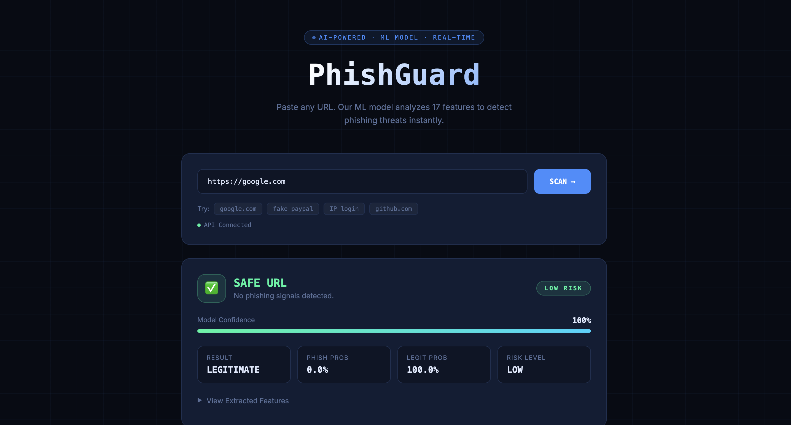

# PhishGuard — ML Phishing URL Detector

PhishGuard checks whether a link is safe or a phishing scam. It combines a
machine learning model with real-time DNS, WHOIS and SSL certificate checks.

🔗 **Live demo:** 👉 https://phishguard-abhilekh.vercel.app



> The backend runs on Render's free plan, so the first scan after a while
> can take ~50 seconds while the server wakes up.

---

## How it works

```
User enters a URL on the website (Vercel)
        ↓
Flask API (Render) /predict
        ↓
1. URL checks      → length, IP address, @ symbol, hyphens, subdomains...
2. DNS check       → does the domain exist?
3. WHOIS check     → how old is the domain? how long is it registered for?
4. SSL check       → is the certificate valid and from a trusted authority?
        ↓
17 features → Random Forest model → Safe / Phishing + probability
```

## Features

- **17-feature Random Forest model** (92.27% accuracy)
- **Real DNS, WHOIS and SSL certificate checks** instead of guessed values
- **Safety rule** that flags raw IP-address URLs as phishing
- **404 response** for domains that don't exist, instead of a wrong verdict
- **503 response** when the WHOIS server times out, instead of guessing
- **24-hour cache** for lookups, so repeat checks are instant
- Production server with **gunicorn**, debug mode off

## Tech Stack

| Part | Technology |
|------|------------|
| ML model | Random Forest (scikit-learn 1.8.0) |
| Dataset | UCI Phishing Websites Dataset (11,055 URLs) |
| Backend | Python, Flask, gunicorn |
| Lookups | dnspython, python-whois, Python `ssl` + `socket` |
| Frontend | HTML, CSS, vanilla JavaScript |
| Deployment | Render (backend), Vercel (frontend) |

## Model Results

All three models were tested on the same 2,211-URL test set (80/20 split).

| Model | Features | Accuracy | Precision | Recall | F1 | Used in app? |
|-------|----------|----------|-----------|--------|----|--------------|
| A — full UCI | 30 | 97.60% | 97.93% | 96.63% | 97.28% | No (research benchmark) |
| B — URL-only | 14 | 90.64% | 89.80% | 88.98% | 89.39% | No (previous version) |
| **C — URL + DNS + WHOIS** | **17** | **92.27%** | **91.07%** | **91.53%** | **91.30%** | **Yes ✅** |

### Why not use the 97.6% model?

16 of the 30 UCI features need data the API can't collect, such as traffic
ranking or the page's HTML. The first version filled them with fixed values,
and real sites like google.com were flagged as phishing. A model is only as
good as the inputs it gets at prediction time, so the app uses only features
it can actually calculate.

Model C adds three features computed live: `DNSRecord`, `age_of_domain` and
`Domain_registeration_length`. This cut missed phishing URLs from 108 to 83.

## Problems found and fixed

- **SSL feature mismatch:** the model relies on `SSLfinal_State` for about 59%
  of its decisions. The old API marked any `https://` URL as safe. It now
  connects to the site and verifies the certificate (trusted authority,
  expiry, hostname).
- **IP-address URLs marked safe:** in the UCI data, IP URLs are almost 50/50
  phishing and legitimate, so the model learned to ignore them. A safety rule
  now flags them.
- **Failed lookups cached as bad results:** WHOIS timeouts were being cached for
  24 hours. Now only successful lookups are cached.
- **Fake subdomains marked safe:** `asmit.in.com` was rated legitimate because
  WHOIS returned the parent domain `in.com`. Domains that don't exist in DNS
  now get a "does not exist" warning.

## Known limitations

- The UCI dataset is from 2015, so some patterns are outdated.
- Phishing pages on trusted free-hosting subdomains (e.g. `*.github.io`) can
  look safe.
- Lookalike domains (e.g. `paypa1.com`) are not specifically detected.
- The cache is in memory, so it resets when the server restarts.

## Project Structure

```
phishguard/
├── backend/    Flask API, lookups (DNS/WHOIS/SSL), trained model
├── frontend/   index.html (the website)
├── ml/         dataset exploration and training scripts
└── docs/       screenshot and feature documentation
```

## Run Locally

```bash
cd backend
python3 -m venv venv
source venv/bin/activate
pip install -r requirements.txt
python3 app.py
```

Then open `frontend/index.html` in a browser. It uses `localhost:8080`
automatically when opened locally.

## Team

Final-year major project, B.Tech CS(AI), PSIT Kanpur.

👉 Atreya Singh Sengar, Ankit Singh, Abhilekh Singh, Abhishek Singh, Anubhav Tiwari

Supervised by Mr. Ashish Kumar Singh, Assistant Professor, Department of AI, PSIT.